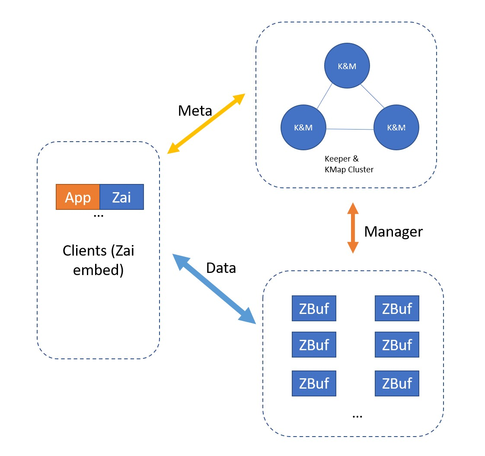

Components
===

The Zai cluster is comprised of four key components in present: 

1. Zai
2. Keeper
3. ZMap
4. ZBuf

## Zai

The Zai is the Input/Output service: Receiving the requests and Returning the result.

The Zai is stateless, so it's horizontally scalable. Access it through load balancing components such as LVS, F5.

And it can be embedded into user's application.

## Keeper

Keeper is the managing component of the entire Zai box. 

There is only one keeper node is active, remaining keeper servers available for high availability only. 

It is recommended to deploy keeper at least three nodes.

## KMap

KMap is the key to oid map. Help to find oid by key. It can be embedded into Keeper.

## ZBuf

ZBuf is used for store data temporally for higher performance.
