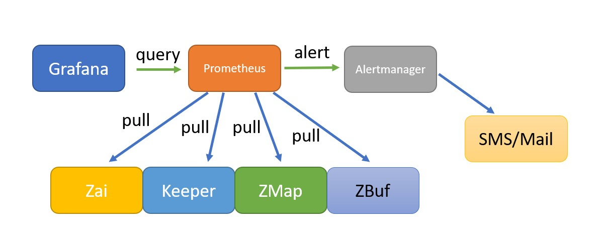

Monitor Overview
====

The Zai monitoring framework adopts two open source projects: Prometheus and Grafana. 
Zai uses Prometheus to store the monitoring and performance metrics and Grafana to visualize these metrics.

